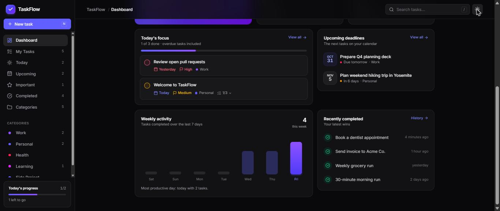

<div align="center">

# ✅ TaskFlow

**A calm, focused task manager with a premium SaaS feel.**

Built with React, TypeScript, Vite and Tailwind CSS. No backend, no sign-up. Your tasks live in your browser.




</div>

## ✨ Features

### 📊 Dashboard
- Time-of-day greeting with today's date and a summary of what's due
- Completion ring with a breakdown of pending tasks by priority
- Stat cards for total, completed, pending and overdue tasks that link to the matching list
- **Today's focus** list, **upcoming deadlines**, **recently completed** tasks and a **7-day activity chart**

### 📝 Task management
- Create, edit, complete and delete tasks
- Title, description, due date, priority (Low, Medium, High), category, tags and subtasks
- Star tasks as **important**
- Delete asks for confirmation first, and the notification lets you **undo**
- New tasks pick up defaults from the current page (for example, tasks added in Today are due today)

### 🗂️ Smart views
| View | Shows |
| --- | --- |
| **My Tasks** | Everything, with open tasks above finished ones |
| **Today** | Tasks due today, plus an **Overdue** section |
| **Upcoming** | Future tasks grouped by date |
| **Important** | Starred tasks |
| **Completed** | Finished tasks grouped by completion date |
| **Categories** | Per-category cards with progress, which you can create and delete |

### 🔍 Filtering and search
- Filter by priority, status and due date (overdue, today, next 7 days, no date)
- Sort by newest, oldest, priority or due date
- Search matches titles, descriptions, categories, tags and subtasks

### 🎨 Experience
- Light and dark themes that follow your system by default, remember your choice, and load without a flash of the wrong theme
- Smooth page transitions, slide-over editor, animated checkboxes and toast notifications
- Responsive layout: sidebar on desktop, slide-out menu and bottom tab bar on mobile
- Accessible: keyboard focus stays inside open dialogs, controls have screen-reader labels, and animations respect your reduced-motion setting

### 💾 Persistence
- Everything is saved to `localStorage` and survives refreshes
- Saved data is checked on load, so corrupted or outdated data won't crash the app
- Changes sync between open browser tabs

## ⌨️ Keyboard shortcuts

| Key | Action |
| --- | --- |
| `N` | New task |
| `/` | Focus search |
| `Ctrl` + `Enter` | Save task in the editor |
| `Esc` | Close a dialog or panel, or clear search |

## 🚀 Getting started

**Requirements:** Node.js 20.19+ or 22.12+ (as required by Vite 8)

```bash
git clone https://github.com/PasinduHima/TaskFlow.git
cd TaskFlow
npm install
npm run dev
```

Then open **http://localhost:5173**.

> On first launch TaskFlow adds a few sample tasks so you can explore. Edit or delete them freely. To start completely fresh, clear the site's local storage.

### Scripts

| Command | Description |
| --- | --- |
| `npm run dev` | Start the development server with hot reload |
| `npm run build` | Type-check and build for production into `dist/` |
| `npm run preview` | Preview the production build locally |
| `npm run lint` | Run ESLint |

## 🧱 Tech stack

- **[React 19](https://react.dev)** with hooks and context for state
- **[TypeScript](https://www.typescriptlang.org)** in strict mode
- **[Vite 8](https://vite.dev)** for development and builds
- **[Tailwind CSS 4](https://tailwindcss.com)** for styling, theming and animations
- **[Lucide](https://lucide.dev)** icons
- **ESLint** with typescript-eslint and the React Hooks rules

There is no router or state-management library. Navigation uses the URL's `#` part, so views survive refreshes and back/forward.

## 📁 Project structure

```
src/
├── app/             # Root component and provider setup
├── components/
│   ├── ui/          # Reusable pieces: Button, Modal, Card, Select, Progress, EmptyState...
│   ├── layout/      # App shell, sidebar, header, mobile tab bar, theme toggle
│   ├── tasks/       # Task item, list, editor form, filter bar, checkbox
│   └── dashboard/   # Stat cards, completion card, activity chart, deadline lists
├── pages/           # Dashboard, task views and categories
├── context/         # Tasks, theme, toasts, confirm dialog and task editor providers
├── hooks/           # Task actions, hash routing, keyboard shortcuts, context hooks
├── services/        # localStorage access and starter data
├── types/           # Shared TypeScript types
├── utils/           # Date helpers, filter/sort/group logic, routes, style tokens
└── styles/          # Global CSS and Tailwind theme
```

The `@/` import alias points to `src/`.

## 🗺️ Ideas for the future

- Drag-and-drop reordering
- Recurring tasks and reminders
- Export and import of tasks as JSON
- Cloud sync with user accounts

## 📄 License

No license has been chosen yet. Add one before accepting outside contributions.
